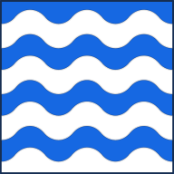

  

<h1 align="center">Westarctican College of Arms</h1>

Creating and recording the armorial heritage of Westarctica

The Westarctican College of Arms creates and records armorial achievements and maintains resources for the study of Westarctican heraldry. Its heraldic work is directed by the Ellsworth King of Arms.

## Services of the College

**Ellsworth** and **WestarcticaNIC** are services of the Westarctican College of Arms.

| Service | Website |
| --- | --- |
| **Ellsworth** — the College’s heraldic website, armorial, and reference library | [ellsworth.westarctica.net](https://ellsworth.westarctica.net) |
| **WestarcticaNIC** | [nic.westarctica.net](https://nic.westarctica.net) |

## Our Work on GitHub

This organization hosts the College’s websites, software, and supporting technical resources.

The [college-of-arms](https://github.com/westarctica/college-of-arms) repository contains the source for Ellsworth, including the public armorial, heraldry guides, and glossary.

To report a technical problem or suggest an improvement, open an issue in the relevant repository. For heraldic inquiries, consult [Ellsworth](https://ellsworth.westarctica.net/grants/).

## Westarctica

[National Website](https://www.westarctica.info/) · [Encyclopedia Westarctica](https://www.westarctica.wiki/)
